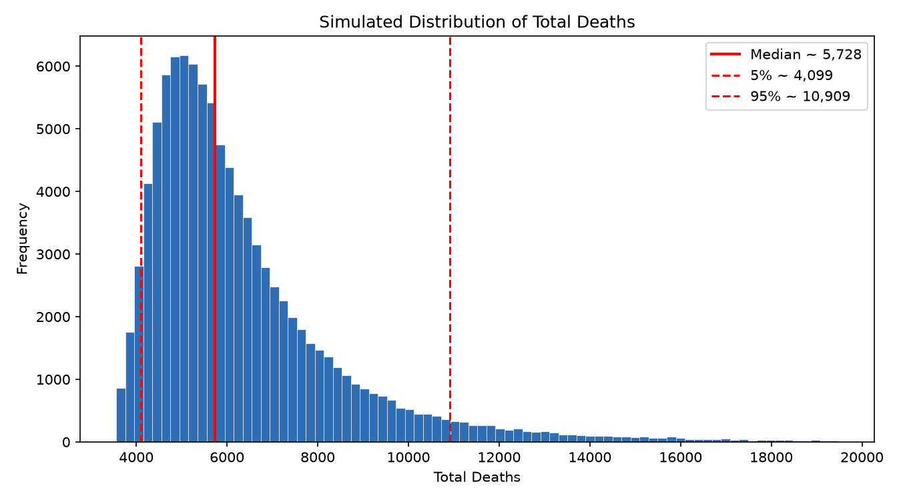
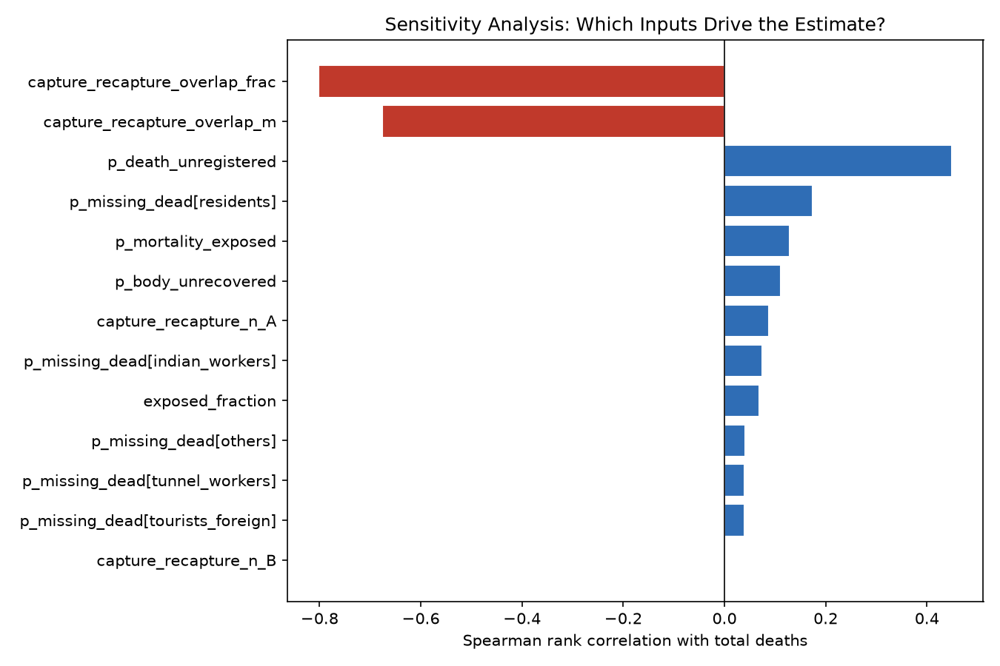

# Nepal Flood — Monte Carlo Death-Toll Estimation

A probabilistic model that estimates the total death toll of a flood disaster by accounting for what official figures miss: missing persons who died, bodies never recovered, and unregistered victims.

```
D_total = D_confirmed + D_missing_dead + D_unrecovered + D_unregistered
```

This is a Python (NumPy/SciPy) implementation of a poster model that was originally built in MATLAB.

## Approach

- **Monte Carlo simulation:** 100,000 runs with a fixed seed, so results are reproducible.
- **Missing persons:** binomial draws with Beta-distributed death probabilities for each category (residents, tunnel workers, foreign tourists, Indian workers and others).
- **Unrecovered bodies:** exposed population × mortality among the exposed × probability that a body is never found.
- **Sensitivity analysis:** a tornado diagram that ranks every stochastic input by its Spearman rank correlation with the final estimate, showing which assumptions drive the result.
- **Single config file:** all parameters live in `config.py`, so the model and the sensitivity analysis can't drift out of sync.

## Run

```bash
python -m venv .venv && source .venv/bin/activate
pip install -r requirements.txt
python nepal_flood_model.py       # output distribution  -> nepal_flood_distribution.png
python sensitivity_analysis.py    # tornado diagram       -> nepal_flood_sensitivity.png
```

## Outputs

| Distribution of estimated total deaths | Sensitivity (tornado) |
|---|---|
|  |  |

## Stack

Python · NumPy · SciPy · Matplotlib
